# 💫 About Me:
### Hi there, I'm Xuan Son 👋

🔭 I’m currently working on scalable full-stack web applications, robust backend architectures, and data-driven systems 
🌱 I’m currently learning advanced system design, cloud-native technologies, and distributed computing 
👯 I’m looking to collaborate on innovative open-source tools, modern web platforms, and automated workflow solutions 
🤝 I’m looking for help with large-scale distributed systems and high-concurrency performance tuning 
💬 Ask me about Full-Stack Development (React, Node.js), Database Design (PostgreSQL), API Architecture & System Optimization 
⚡ Fun fact: Always obsessed with optimization — from complex SQL queries to my morning coffee ☕⚡ 

## 🌐 Socials:
       

# 💻 Tech Stack:
                                                             
# 📊 GitHub Stats:
 
 

# 🚀 Featured Projects:

| Dự án | Mô tả | Công nghệ | GitHub | Live Demo |
| :--- | :--- | :--- | :--- | :--- |
| **Đi Thôi! (LetGoo)** | Trợ lý du lịch AI, lập lịch trình tuần tự vẽ lộ trình bản đồ, cảnh báo ngâm quán & phòng vote nhóm | `React 18` `Spring Boot 3` `Gemini AI` `Leaflet` | [💻 Repository](https://github.com/s0nbuildtech287/dontalk_letgo) | [🔗 Live Demo](https://dontalk-letgo.vercel.app/) |
| **Oniscenary Film Pro** | Nền tảng xem phim 4K UltraHD, anime vietsub, tủ phim cá nhân, chế độ Smart TV & Trợ lý AI Gemini | `React 19` `TypeScript` `TailwindCSS` `Gemini AI` `HLS` | [💻 Repository](https://github.com/s0nbuildtech287/oniscenary_store) | [🔗 Live Demo](https://oniscenary-store.vercel.app/) |
| **MyWallet Hub** | Quản trị & phân tích đa tài sản thông minh, Intro 3D điện ảnh, mô phỏng tích sản DCA từ 2020, mô hình tối ưu Markowitz MPT & đồng bộ Google Sheets Cloud DB | `React 19` `Vite` `TailwindCSS` `Python FastAPI` `Express 3-Tier` `Google Sheets Cloud` | [💻 Repository](https://github.com/s0nbuildtech287/MyWallet) | [🔗 Live Demo](https://mywallethub-alpha.vercel.app/) |
| **BodyGym** | Nền tảng thể hình với 1,324+ bài tập, Live Workout Tracker, giáo án cá nhân & dashboard thống kê | `React` `Vite` `PWA` `Vercel` | [💻 Repository](https://github.com/s0nbuildtech287/body_gym) | [🔗 Live Demo](https://body-gym-five.vercel.app/) |
| **Make Your Plan** | Vũ trụ lập kế hoạch & Sơ đồ tư duy Canvas 3D đối xứng 2 bên, Showcase điện ảnh, Trợ lý Gemini AI & đồng bộ Google Sheets / Java Backend | `React 19` `TypeScript` `TailwindCSS` `Spring Boot 3` `Google Sheets` `Gemini AI` | [💻 Repository](https://github.com/s0nbuildtech287/MakeYourPlan) | [🔗 Live Demo](https://make-your-plan.vercel.app/) |
| **MySocial** | Trung tâm quản lý tài khoản & mạng xã hội cá nhân với bảo mật khóa hình vẽ (Pattern Lock) | `React` `TypeScript` `Glassmorphism` | [💻 Repository](https://github.com/s0nbuildtech287/mysocial) | [🔗 Live Demo](https://mysocial-liart.vercel.app/) |
| **Better Than Yesterday** | Hệ thống rèn luyện kỷ luật, Showcase 3D, Habit Heatmap chuẩn GitHub, quản trị 6 hũ tài chính & Backend Java Spring Boot 3 RESTful API | `Next.js 14` `Spring Boot 3` `PostgreSQL` `Supabase` `TailwindCSS` | [💻 Repository](https://github.com/s0nbuildtech287/better_than_yesterday) | [🔗 Live Demo](https://betterthanyesterday-eight.vercel.app/) |
| **Drobe Closet** | Số hóa & quản lý tủ đồ cá nhân, tự động tách nền ảnh bằng AI local & phối đồ Canvas | `React` `Node.js` `Prisma` `Python AI` | [💻 Repository](https://github.com/s0nbuildtech287/MyCloset) | [🔗 Live Demo](https://my-closet-frontend.vercel.app/) |
| **Auto Music Player** | Ứng dụng nghe nhạc nội bộ, đặt nhạc từ xa qua Google Sheet & hàng đợi công bằng | `Electron` `Node.js` `Google Apps Script` `yt-dlp` | [💻 Repository](https://github.com/s0nbuildtech287/MusicAutoPlay) | [🔗 Live Demo](https://music-auto-play-git-deploy-xu4ns0ns-projects.vercel.app/) |
| **AI Account Pool** | Quản lý và theo dõi trạng thái sử dụng pool tài khoản AI (Cursor, Claude, ChatGPT...) | `React` `Vite` `LocalStorage` `HTML5 Canvas` | [💻 Repository](https://github.com/s0nbuildtech287/ai-account-pool) | [🔗 Live Demo](https://ai-account-pool.vercel.app/) |
| **Stock System** | Trạm phân tích định lượng & tối ưu hóa danh mục Markowitz MPT, vnstock realtime & định giá cổ phiếu VN | `Next.js` `TailwindCSS` `Recharts` `vnstock` | [💻 Repository](https://github.com/s0nbuildtech287/Stocks_System) | [🔗 Live Demo](https://stocks-system-silk.vercel.app/) |
| **Practice English** | Nền tảng luyện thi tiếng Anh học thuật CEFR (A1-C2), 4 kỹ năng độc lập, AI Gemini Tutor & SRS | `HTML5/CSS3` `JavaScript` `Gemini AI` `Web Speech` | [💻 Repository](https://github.com/s0nbuildtech287/English_Practice_System) | [🔗 Live Demo](https://englistpractice.vercel.app/) |

| **ReownShop** | Modern secondhand marketplace with product discovery, seller listings, offers, escrow-oriented checkout, order tracking, chat, reviews and dispute flows | `React` `Vite` `Spring Boot` `Java 21` `PostgreSQL` `Redis` `WebSocket` | [Repository](https://github.com/s0nbuildtech287/ReownShop) | Coming soon |

## ReownShop

**ReownShop** is a modern secondhand marketplace focused on making peer-to-peer transactions clearer and safer. The platform brings product discovery, seller storefronts, offers, checkout, escrow-oriented order tracking, real-time chat, reviews and dispute handling into one polished experience.

- Repository: https://github.com/s0nbuildtech287/ReownShop
- Stack: React, Vite, Spring Boot, Java 21, PostgreSQL, Redis and WebSocket.

## MySocial

**MySocial** is a personal command center for organizing social, developer, business and startup accounts in one polished workspace. It includes an animated intro, guest demo mode, category-based account cards, service logos, Statistics/Business/Startup dashboards, JSON backup and Pattern Lock protection for sensitive actions.

- 🌐 Live demo: https://mysocial-liart.vercel.app/
- 💻 Repository: https://github.com/s0nbuildtech287/mysocial
- 🧰 Stack: React 19, TypeScript, Vite, Tailwind CSS, Lucide React and Spring Boot/PostgreSQL backend structure.

## MyWallet Hub

**MyWallet Hub (Quant & DCA PRO)** is a next-generation multi-asset investment management and quantitative finance platform. It features a cinematic 3D Matrix Intro Showcase, barrier-free Guest Exploration Mode, historical DCA backtesting with real market data dating back to 2020, Wall Street quantitative models (Markowitz Modern Portfolio Theory, CAPM, Dividend Discount Model via Python FastAPI microservice), modular 3-tier Node.js Express backend, and serverless cloud database synchronization powered by Google Sheets Apps Script API + Offline-First LocalStorage.

- 🌐 Live demo: https://mywallethub-alpha.vercel.app/
- 💻 Repository: https://github.com/s0nbuildtech287/MyWallet
- 🧰 Stack: React 19, Vite, Tailwind CSS, Python FastAPI (NumPy/Pandas/SciPy), Node.js Express (Modular 3-Tier Architecture), Google Apps Script Web App, Chart.js & SVG Canvas.

