# 💫 About Me:
### Hi there, I'm Xuan Son 👋

🔭 I’m currently working on scalable full-stack web applications, robust backend architectures, and data-driven systems 
🌱 I’m currently learning advanced system design, cloud-native technologies, and distributed computing 
👯 I’m looking to collaborate on innovative open-source tools, modern web platforms, and automated workflow solutions 
🤝 I’m looking for help with large-scale distributed systems and high-concurrency performance tuning 
💬 Ask me about Full-Stack Development (React, Node.js), Database Design (PostgreSQL), API Architecture & System Optimization 
⚡ Fun fact: Always obsessed with optimization — from complex SQL queries to my morning coffee ☕⚡ 

## 🌐 Socials:
       

# 💻 Tech Stack:
                                                             
# 📊 GitHub Stats:
 
 

# 🚀 Featured Projects:

| Dự án | Mô tả | Công nghệ | GitHub | Live Demo |
| :--- | :--- | :--- | :--- | :--- |
| **TravelEasy** | Ra-đa giám sát hàng không & hàng hải thời gian thực, Live ATC Scanner & bản đồ vệ tinh | `React 19` `FastAPI` `WebSocket` `Leaflet` | [💻 Repository](https://github.com/s0nbuildtech287/RadarMonitor) | [🔗 Live Demo](https://radarmonitor.onrender.com/) |
| **MyWallet Hub** | Nền tảng phân tích tài chính định lượng, backtest DCA & Trợ lý đầu tư AI chuyên sâu | `React` `Node.js` `Chart.js` `OpenAI` | [💻 Repository](https://github.com/s0nbuildtech287/Stocks_System) | [🔗 Live Demo](https://mywallethub-alpha.vercel.app/) |
| **BodyGym** | Nền tảng thể hình PWA với 1,324+ bài tập, Live Workout Tracker & Muscle Heatmap | `Java` `Spring Boot 3` `PWA` `Chart.js` | [💻 Repository](https://github.com/s0nbuildtech287/body_gym) | [🔗 Live Demo](https://body-gym.onrender.com/) |
| **Make Your Plan** | Lập kế hoạch phân cấp & Sơ đồ tư duy Canvas (Mindmap) tương tác cao với Gemini AI | `React` `TypeScript` `TailwindCSS` `Gemini AI` | [💻 Repository](https://github.com/s0nbuildtech287/yourplan) | [🔗 Live Demo](https://yourplan-two.vercel.app/) |
| **MySocial** | Trung tâm quản lý tài khoản & mạng xã hội cá nhân với bảo mật khóa hình vẽ (Pattern Lock) | `React` `TypeScript` `Glassmorphism` | [💻 Repository](https://github.com/s0nbuildtech287/mysocial) | [🔗 Live Demo](https://mysocial-liart.vercel.app/) |
| **Better Than Yesterday** | Dashboard rèn luyện kỷ luật, Habit Heatmap chuẩn GitHub & quản lý 6 hũ tài chính | `Next.js 14` `Prisma` `PostgreSQL` `Supabase` | [💻 Repository](https://github.com/s0nbuildtech287/better_than_yesterday) | [🔗 Live Demo](https://betterthanyesterday-eight.vercel.app/) |
| **Drobe Closet** | Số hóa & quản lý tủ đồ cá nhân, tự động tách nền ảnh bằng AI local & phối đồ Canvas | `React` `Node.js` `Prisma` `Python AI` | [💻 Repository](https://github.com/s0nbuildtech287/MyCloset) | [🔗 Live Demo](https://my-closet-frontend.vercel.app/) |
| **Auto Music Player** | Ứng dụng nghe nhạc nội bộ, đặt nhạc từ xa qua Google Sheet & hàng đợi công bằng | `Electron` `Node.js` `Google Apps Script` `yt-dlp` | [💻 Repository](https://github.com/s0nbuildtech287/MusicAutoPlay) | [🔗 Live Demo](https://music-auto-play-git-deploy-xu4ns0ns-projects.vercel.app/) |
| **AI Account Pool** | Quản lý và theo dõi trạng thái sử dụng pool tài khoản AI (Cursor, Claude, ChatGPT...) | `React` `Vite` `LocalStorage` `HTML5 Canvas` | [💻 Repository](https://github.com/s0nbuildtech287/ai-account-pool) | [🔗 Live Demo](https://ai-account-pool.vercel.app/) |

